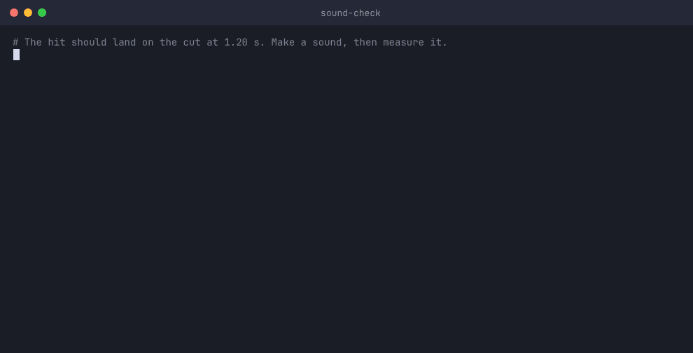
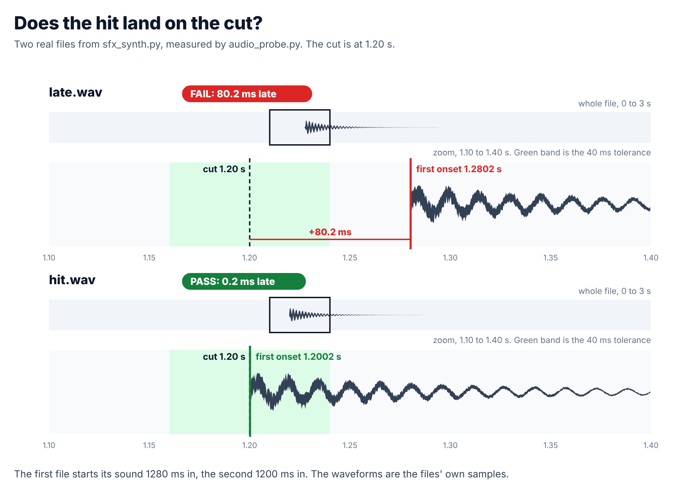
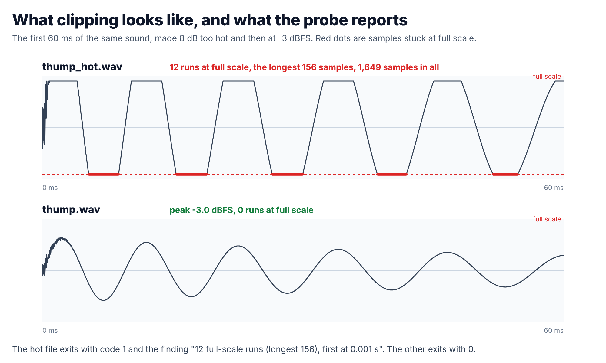
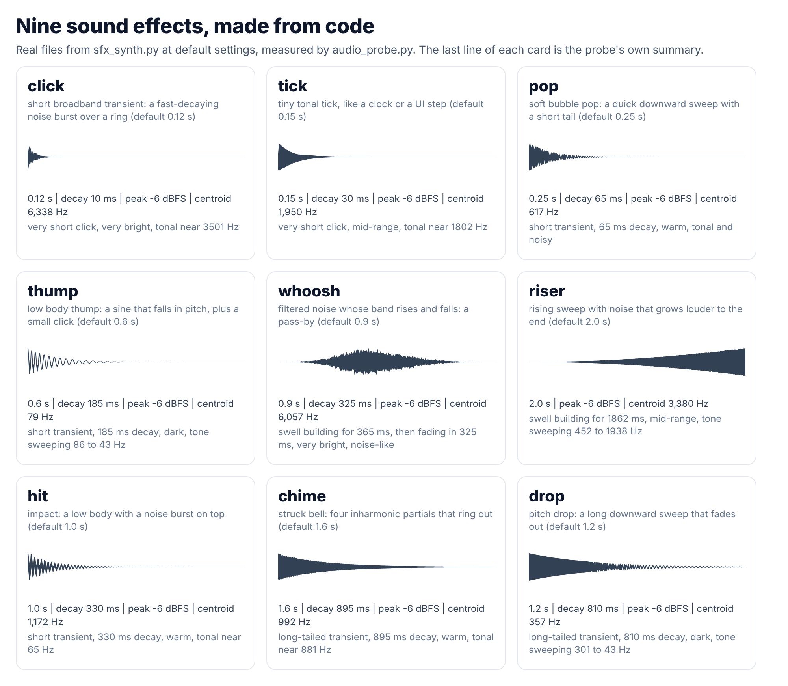
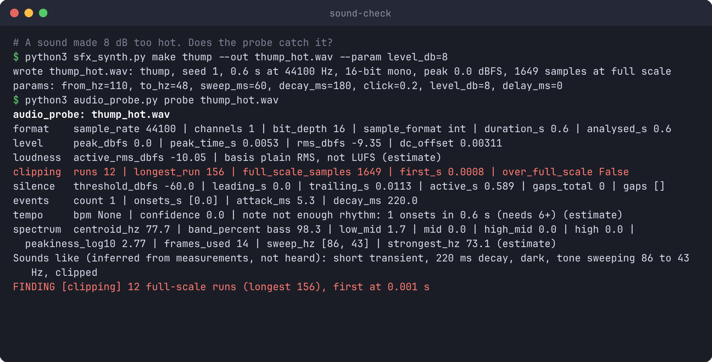
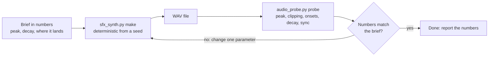

<p align="center"></p>
<h1 align="center">Sound Check</h1>
<p align="center"><b>Your agent cannot hear what it made. This tells it how many milliseconds late the hit lands.</b></p>
<p align="center">
  <a href="https://github.com/FinnTech3/sound-check/actions/workflows/ci.yml"></a>
  
  
  
  
</p>
<p align="center"></p>

<sub>Real run on 15 Nov 2026. Nothing in the clip is edited. The sounds are synthetic, made by `sfx_synth.py` in the same run.</sub>

## The straight answer

- **What it does.** `audio_probe.py` reads a WAV and reports evidence: peak, clipping, DC offset, silence, onsets, decay, tempo, spectrum, stereo phase, and how many milliseconds a sound lands from each cut time you give it. `sfx_synth.py` writes nine kinds of sound effect from code, so an agent can make a sound, measure it, adjust and measure again.
- **What it needs.** Python 3.10 or newer. Two files, standard library only. No network, no API key, no ffmpeg.
- **What it won't do.** Hear. There is no model, so no taste, quality or genre. Where a number is an estimate it says so, and where there is nothing to say it says "not enough rhythm" instead of guessing.

## See it work

<p align="center"></p>

**The sync check.** The same hit, started 1280 ms and then 1200 ms into a 3 s file, against a cut at 1.20 s. The waveforms are the files' own samples. The first is 80.2 ms late and fails a 40 ms tolerance. The second passes.

<p align="center"></p>

**Clipping, found and located.** The same sound made 8 dB too hot and then at -3 dBFS. The probe reports 12 runs at full scale, the longest 156 samples, and exits with code 1.

<p align="center"></p>

**Nine presets.** Click, tick, pop, thump, whoosh, riser, hit, chime and drop, each a real file at default settings with the numbers the probe measured. The last line of each card is the probe's own summary, inferred from numbers and not heard.

<details>
<summary>The full probe output behind the clipping image (terminal)</summary>

<p align="center"></p>

</details>

## Run it in 60 seconds

Needs Python 3.10 or newer. Each script is one file, so you can also copy it anywhere and run it.

```bash
git clone https://github.com/FinnTech3/sound-check
cd sound-check/agensi/sound-check/scripts
python3 sfx_synth.py list                                     # the presets and their parameters
python3 sfx_synth.py make thump --out thump.wav --param level_db=8   # clips on purpose
python3 audio_probe.py probe thump.wav                        # exit 1: clipping found
```

Check a file against cut times (positive offset means late):

```bash
python3 audio_probe.py probe film.wav --cuts 1.20,3.40 --tolerance-ms 40
python3 audio_probe.py probe film.wav --json
```

| Option | Meaning |
|---|---|
| `--json` | JSON instead of text. |
| `--cuts 1.2,3.4` | Cut times in seconds. Each is matched to the nearest onset and reported in milliseconds. |
| `--tolerance-ms` | Sync tolerance, default 40. |
| `--silence-db` | Level below which audio counts as silent, default -60. |
| `--max-seconds` | Analysis cap, default 1200. |

Exit codes: `0` clean, `1` findings (clipping, DC offset, silence, truncation, mono cancellation, failed sync), `2` bad input (a missing or non-WAV file, a bad option value, a path that is not a regular file).

`sfx_synth.py make PRESET --out FILE.wav` also takes `--seed`, `--duration`, `--rate`, `--param key=value`, `--force` and `--json`. It will not replace an existing file without `--force`.

## Use it with your agent

[`agensi/sound-check`](agensi/sound-check) is the skill: `SKILL.md`, both scripts, four references and examples. Install it from the Agensi listing, or drop that folder into your agent's skills folder.

1. Ask: "Is demo-audio.wav clipping?", "Does the hit land on the cut at 1.20 s?" or "Make a click for the submit button and check it."
2. The agent writes each script unchanged to a temporary file, runs it, and deletes it.
3. It answers with a verdict, a short table of the numbers that matter, the "sounds like" line labelled as inferred, which numbers are estimates, and one next step.
4. For a fix it writes a new file and probes that again. It never overwrites your original.

| Cost | What it means |
|---|---|
| Time | Ten minutes of 44.1 kHz stereo took 5.6 seconds to probe when I rechecked |
| Permissions | Run two Python scripts from temporary files |
| Network | None |
| Files | The probe reads the WAV you name and writes nothing. The synthesiser writes one WAV, only where you say |
| Money | Nothing here. The code is MIT. The Agensi upload is built from the skill folder in this repo |

## How it works



`decay_ms` in the synthesiser means the same thing as `events.decay_ms` in the probe (time to fall 20 dB), so what you ask for and what you measure can be compared directly. [presets.md](agensi/sound-check/references/presets.md) lists which knob moves which number.

## Why it's built this way

- **Two scripts, one file each.** I keep each to a single self-contained file so an agent can run it from a temporary file with nothing installed. Each stays under 20 KB, which is why the code is dense and why the explanations live in `references/`.
- **Standard library only.** WAV parsing, the FFT, the onset detector and the tempo estimate are all plain Python. No numpy, no ffmpeg, no model.
- **Bounded cost.** At most 1200 seconds of audio are read, at most 64 spectrum frames are used, and the tempo reads 120 seconds at most.
- **Estimates are labelled.** Loudness, tempo, spectrum and the summary line are marked as estimates in the JSON and the text. Loudness is a plain RMS and is never called LUFS, because it is not.
- **Safe on bad files.** Truncated, corrupt, empty and fuzzed files give an exit code and one line, not a traceback.
- **Nothing gets overwritten.** The probe only reads. The synthesiser writes only the path you give it.

## What it won't do

- Hear. No "this sounds expensive", no taste, no genre.
- Read mp3, ogg, flac or m4a. Convert to WAV first. It never installs a converter.
- Find clipping that was turned down afterwards. It finds samples at full scale.
- Give you LUFS. For a real loudness target use a real loudness meter.
- Find an onset hidden under the tail of a louder sound.
- Measure true peak (it reports sample peak), or record, edit or write music.

Also: WAV PCM 8, 16, 24, 32-bit and float 32/64-bit, up to 8 channels. The presets are small synthesis recipes, not recordings. The tests pass on Python 3.10 to 3.13 on Linux. I did not test Windows or macOS.

## Develop / verify

```bash
pip install -e ".[dev]"
pytest -q                                              # 170 offline tests on synthetic WAVs
ruff check .
python3 tools/agensi_build.py agensi/sound-check       # Agensi checker, builds dist/
```

The media is real. `docs/media-src/regen.sh` makes the sounds, probes them and redraws every image, clip and listing screenshot (needs Pillow, Node with Playwright and ffmpeg). The sounds are deterministic, so the numbers only change if the scripts do. `probe-results.json` there holds the probe numbers the images were drawn from.

## Finn's take

Agents are confident about things they have never checked, and audio is the worst case: they cannot hear it and will happily say it sounds fine. I'd rather the agent said "peak -3.0 dBFS, 12 clipped runs, 80 ms late" than "sounds great". It is not a replacement for listening. It is the thing that stops you shipping a file that was never checked at all.

Built by FinnTech3.

## Licence

MIT, see [LICENSE](LICENSE).
